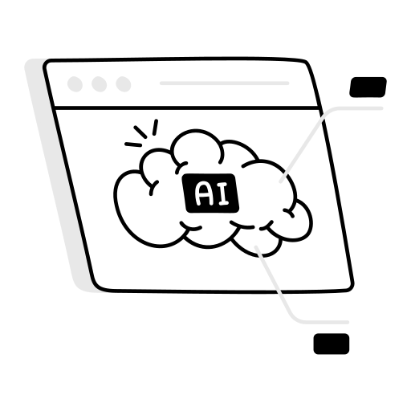
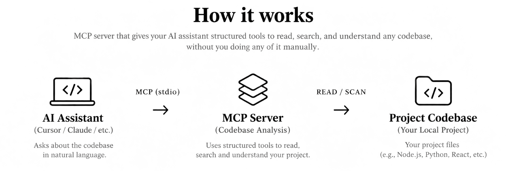

# MCP Server for Codebase Analysis

**MCP Workspace Context** is a Model Context Protocol (MCP) server that helps AI assistants read, search, and understand local codebases through structured tools.

Connect it to an MCP-compatible AI assistant, such as Cursor, to explore project structure, find entry points, trace dependencies, identify technologies, and search source code without manually copying files into the chat.

Built for developers who want their AI assistants to understand the actual project rather than guess how it works.

<div align="center">
  
</div>

---

## Features

MCP Workspace Context provides eight tools for codebase analysis:

| Tool | Description |
|------|-------------|
| **Find Entry Points** | Finds common entry files such as `index.ts`, `main.py`, `Dockerfile`, and others. |
| **List Dependencies** | Identifies local imports used by a specific file. |
| **Summarize Folder** | Examines a folder and identifies its likely purpose, such as API, models, utilities, or tests. |
| **Read File** | Reads file contents while restricting access to the configured workspace root. |
| **Get File Tree** | Generates the project directory structure while respecting `.gitignore` patterns. |
| **Detect Stack** | Examines configuration files such as `package.json`, `requirements.txt`, and `go.mod` to identify technologies. |
| **Search Code** | Searches source files using keywords or regular expressions, returning file paths and line numbers. |
| **Find TODOs** | Finds `TODO`, `FIXME`, `HACK`, and `NOTE` comments, grouped by file. |

---

## Installation

### Prerequisites

- Node.js v18 or later
- npm
- An MCP-compatible AI assistant, such as Cursor

### 1. Clone the Repository

```bash
git clone https://github.com/bhavjsh/MCP-Workspace-Context.git
cd MCP-Workspace-Context
```

### 2. Install Dependencies

```bash
npm install
```

### 3. Build the Project

```bash
npm run build
```

This compiles the TypeScript source code into JavaScript in the `dist/` directory.

---

## Configuration

### Connect to Cursor

1. Open **Cursor Settings > MCP**.
2. Add a new MCP server configuration.
3. Set the command to Node.js and provide the absolute path to the compiled server.
4. Set `cwd` to the root directory of the project you want to analyze.

Example configuration:

```json
{
  "mcpServers": {
    "mcp-workspace-context": {
      "command": "node",
      "args": [
        "/absolute/path/to/MCP-Workspace-Context/dist/index.js"
      ],
      "cwd": "/absolute/path/to/your-project"
    }
  }
}
```

**Note:**
- Replace the example paths with actual absolute paths on your system.
- On Windows, use escaped backslashes (`\\`) or forward slashes (`/`) in JSON paths.
- The `cwd` property determines which project the server analyzes.
- Restart Cursor or reload the MCP configuration after making changes.

Once connected, the available tools can be accessed by the AI assistant.

---

## Usage

Ask your AI assistant questions about the connected project.

| Example Prompt | Expected Action |
|----------------|-----------------|
| "Show me the project structure." | Retrieves the directory tree. |
| "What technologies does this project use?" | Detects the technology stack. |
| "Where is authentication implemented?" | Searches relevant source files. |
| "What are the entry points?" | Identifies common application entry files. |
| "Find all TODO comments." | Lists TODOs and FIXMEs across the codebase. |
| "What does this file import?" | Identifies local dependencies. |
| "What is the purpose of this folder?" | Summarizes the folder's likely role. |
| "Read the package.json file." | Returns the requested file's contents. |

The assistant can use these tools to retrieve information directly from the configured workspace, reducing the need to manually share source files.

---

## Architecture

MCP Workspace Context connects an AI assistant to a local project through the Model Context Protocol.

<div align="center">
  
</div>

### Core Components

**1. MCP Server**

The main entry point, `src/index.ts`, initializes the MCP server and exposes the available codebase analysis tools.

**2. Analysis Tools**

The `src/tools/` directory contains the tools responsible for reading files, searching code, analyzing dependencies, detecting the technology stack, and exploring project structure.

**3. Workspace Security**

The `src/utils/sandbox.ts` utility resolves file paths and checks that they remain within the configured workspace root before file access.

**4. Gitignore Filtering**

The `src/utils/gitignore.ts` utility loads `.gitignore` patterns to exclude ignored files and directories during file traversal.

### Technical Details

| Component | Implementation |
|-----------|----------------|
| Protocol | Model Context Protocol (MCP) |
| Transport | Standard Input/Output (`stdio`) |
| Runtime | Node.js |
| Language | TypeScript |
| MCP Integration | `@modelcontextprotocol/sdk` |
| Input Validation | Zod |
| File Access | Workspace-root path validation |
| File Filtering | Runtime `.gitignore` pattern matching |

---

## Project Structure

```text
MCP-Workspace-Context/
├── assets/
│   └── mcp.png
├── src/
│   ├── index.ts
│   ├── tools/
│   │   ├── findEntryPoints.ts
│   │   ├── listDependencies.ts
│   │   ├── summarizeFolder.ts
│   │   ├── readFile.ts
│   │   ├── getFileTree.ts
│   │   ├── detectStack.ts
│   │   ├── searchCode.ts
│   │   └── findTodos.ts
│   └── utils/
│       ├── sandbox.ts
│       └── gitignore.ts
├── .gitignore
├── LICENSE
├── README.md
├── package-lock.json
├── package.json
└── tsconfig.json
```

---

## Tech Stack

- **Node.js** — JavaScript runtime for executing the MCP server.
- **TypeScript** — Provides type safety and maintainable source code.
- **[@modelcontextprotocol/sdk](https://github.com/modelcontextprotocol/typescript-sdk)** — Implements MCP server functionality and tool communication.
- **[Zod](https://github.com/colinhacks/zod)** — Validates tool inputs.
- **tsx** — Runs TypeScript during development.

---

## Development

Install project dependencies:

```bash
npm install
```

Run the server in development mode:

```bash
npm run dev
```

Compile TypeScript:

```bash
npm run build
```

Run the compiled server:

```bash
npm start
```

The server communicates through standard input and output using MCP. It is intended to be launched by an MCP-compatible client rather than used as a conventional interactive terminal application.

---

## Security

MCP Workspace Context includes safeguards for local codebase access:

- **Workspace Boundaries:** File paths are resolved and checked against the configured workspace root.
- **Input Validation:** Tool inputs are validated using Zod.
- **Gitignore Support:** Ignored files and directories are excluded from supported file traversal operations.
- **Local Analysis:** The server operates on the configured local project directory.

**Important:** Connect the server only to trusted MCP clients and configure its workspace to a directory you intend to make accessible for analysis.

---

## License

This project is licensed under the MIT License. See the [LICENSE](LICENSE) file for details.

---

## Author

Developed by [Bhavini Joshi](https://github.com/bhavjsh).

**Repository:** [MCP-Workspace-Context](https://github.com/bhavjsh/MCP-Workspace-Context)
